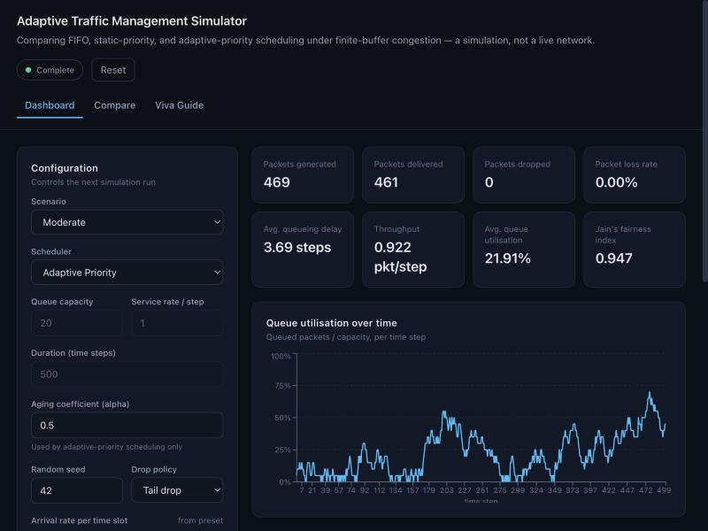
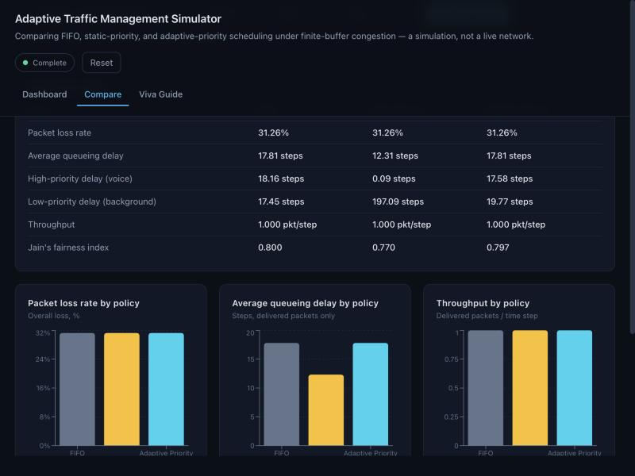
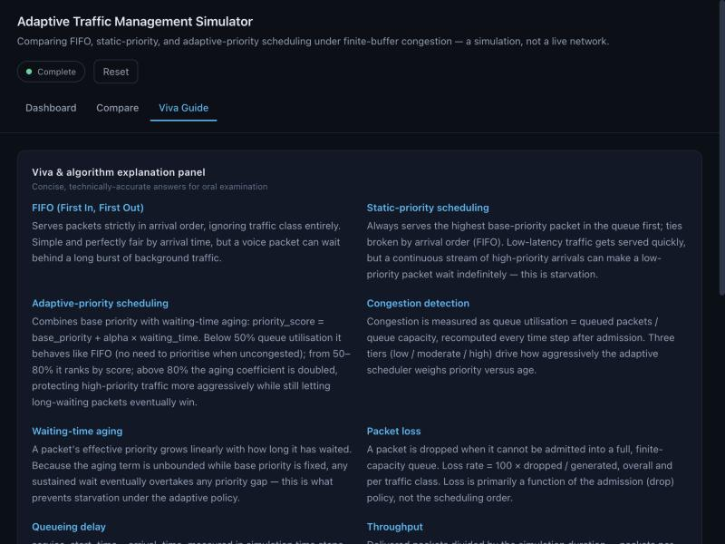

# Adaptive Traffic Management for Reducing Packet Loss in Congested Networks

A small discrete-time packet-network simulator built for a Computer Networks
course project. It compares **FIFO**, **static-priority**, and
**adaptive-priority** scheduling at a single congested bottleneck queue, and
measures how each affects packet loss, delay, throughput, and fairness.

> **This is a simulation.** It does not implement a real router, does not run
> on an actual network, and does not change traffic anywhere outside this
> program. See [Limitations](#limitations).



## 1. Problem statement

Congested network links must decide, moment to moment, which queued packets
to serve and which to drop. Simple FIFO scheduling treats all traffic
equally, which can hurt latency-sensitive classes (voice, gaming) under
load. Static priority protects those classes but risks starving low-priority
traffic indefinitely. This project implements and measures an
**adaptive-priority** scheduler that combines fixed class priority with
waiting-time aging, and asks: does it meaningfully improve on the two
simpler baselines, and under what conditions?

## 2. Objectives

1. Implement FIFO, static-priority, and adaptive-priority scheduling over a
   shared finite-capacity queue.
2. Separate the effect of **scheduling** (service order) from the effect of
   **buffer admission** (which packets get dropped) — these are often
   conflated, and the project brief specifically asked them to be isolated
   (see [Experiment methodology](#experiment-methodology)).
3. Measure packet loss, queueing delay, throughput, queue utilisation, and
   Jain's fairness index from real simulation output — never hardcoded.
4. Demonstrate, with evidence, that waiting-time aging prevents starvation
   under the adaptive policy, and that static priority does **not**.
5. Present it through a small, explainable dashboard suitable for a live
   classroom demo and a detailed oral exam (viva).

## 3. Architecture

```
adaptive-traffic-management/
├── backend/
│   ├── main.py           FastAPI endpoints only — no simulation logic
│   ├── models.py         Pydantic request/response schemas
│   ├── traffic.py        Packet model + Bernoulli arrival generator
│   ├── schedulers.py     FIFO / static-priority / adaptive-priority selection
│   ├── simulator.py      The discrete-time event loop + admission/drop policy
│   ├── metrics.py        Loss, delay, throughput, utilisation, Jain's index
│   ├── experiments.py    Scenarios, Mode A/B comparisons, CSV export
│   ├── run_experiments.py  Regenerates results/ from scratch
│   ├── requirements.txt
│   └── tests/            61 unit tests + 11 API tests (pytest)
├── frontend/
│   └── src/
│       ├── pages/        Dashboard, Compare, Viva
│       ├── components/   ConfigPanel, MetricCards, QueueView, charts/
│       └── api/          Thin fetch wrapper around the backend
├── results/               CSV output from run_experiments.py (real, not invented)
└── docs/screenshots/
```

The scheduling modules (`schedulers.py`) never touch admission or drops —
that boundary is deliberate (see [Section 5](#5-why-scheduling-and-buffer-admission-are-kept-separate)).
`main.py` only validates requests and calls into `simulator`/`metrics`/`experiments`;
no scheduling logic lives in the API layer.

## 4. Algorithms

### FIFO
Serves the oldest queued packet first. Priority is ignored entirely.

### Static priority
Serves the highest base-priority packet first; ties broken by arrival order
(FIFO). A continuous stream of high-priority arrivals can **starve** a
low-priority packet indefinitely — this is demonstrated, not just claimed
(`test_static_priority_allows_overtaking` in `tests/test_schedulers.py`).

### Adaptive priority

```
priority_score(packet, t) = base_priority(class) + alpha_effective * waiting_time(packet, t)
waiting_time(packet, t)   = t - packet.arrival_time        (simulation time steps)
```

Congestion tiers (by queue utilisation = queued / capacity, recomputed every
time step):

| Utilisation | Behaviour |
|---|---|
| < 50% (low) | FIFO-like — priority ignored |
| 50–80% (moderate) | Rank by `priority_score`, `alpha_effective = alpha` |
| > 80% (high) | Rank by `priority_score`, `alpha_effective = 2 × alpha` |

Because the aging term grows without bound while base priority is fixed, any
sustained wait eventually overtakes any priority gap — this is what prevents
starvation, and it's tested directly
(`test_adaptive_prevents_starvation_under_sustained_high_priority_load`).

Traffic classes and (illustrative, project-defined, not industry-standard)
base priorities:

| Traffic class | Base priority |
|---|---:|
| Voice | 5 |
| Gaming / Control | 5 |
| Video | 4 |
| Normal Data | 3 |
| File Transfer | 2 |
| Background | 1 |

## 5. Why scheduling and buffer admission are kept separate

Under a **shared finite buffer with the same drop-tail rule**, changing the
service order alone does not necessarily change total packet loss — loss is
driven by admission, not scheduling. The simulator therefore supports two
experiment modes:

- **Mode A — scheduling only**: all three schedulers run on the *same*
  arrival trace, capacity, service rate, and (tail-drop) admission rule. This
  isolates scheduling's effect on delay/throughput/fairness, and total loss
  is reported honestly — often identical across all three policies.
- **Mode B — congestion protection**: the adaptive scheduler only, comparing
  plain tail-drop admission against a class-aware **priority_displace**
  admission rule (an arriving higher-priority packet may evict a queued
  lower-priority one when the buffer is full). Every eviction is tracked by
  class and reason. The README does not claim this reduces *overall* loss —
  see the real results below, where it sometimes doesn't.

## 6. Formulas

- **Packet loss rate** = 100 × dropped / generated (overall and per class)
- **Queueing delay** = `service_start_time − arrival_time`, delivered packets only, averaged
- **Throughput** = delivered packets / simulation duration
- **Queue utilisation** = queued packets / capacity (average and maximum reported)
- **Jain's fairness index** = `(Σxᵢ)² / (n·Σxᵢ²)`, where `xᵢ` is each class's delivered throughput

## 7. Assumptions

- Discrete, logical time — no real-time sleeps.
- Arrivals: independent Bernoulli trials per traffic class per time slot (at
  most one packet per class per slot). This is a simplification; real
  traffic is often bursty/self-similar.
- All packets are the same size.
- Single bottleneck queue and one output link — no routing, no multi-hop
  topology.
- Base priorities (table above) are project-defined for this simulation, not
  a real QoS/DSCP standard.

## 8. Installation

Requires Python 3.10+ and Node.js 18+.

```bash
cd backend
python3 -m venv .venv
source .venv/bin/activate
pip install -r requirements.txt
```

```bash
cd frontend
npm install
```

## 9. Running it

Backend (from `backend/`, with the venv active):

```bash
uvicorn main:app --reload --port 8000
```

Frontend (from `frontend/`, in another terminal):

```bash
npm run dev
```

The dev server proxies `/api` to `http://127.0.0.1:8000`, so both must be
running. Open the URL Vite prints (defaults to `http://localhost:5173`,
configured here to `5842` to avoid a port clash — see `vite.config.js`).

## 10. Testing

```bash
cd backend
source .venv/bin/activate
pytest -q
```

72 tests (`test_traffic.py`, `test_schedulers.py`, `test_simulator.py`,
`test_metrics.py`, `test_experiments.py`, `test_api.py`), all passing as of
the last run. Coverage includes FIFO order, static-priority ordering and
starvation risk, adaptive behaviour at each congestion tier, adaptive
starvation *prevention*, queue capacity enforcement, drop accounting with no
double-counting, non-negative queueing delay, deterministic seeded runs,
identical traces across Mode A policies, empty/zero traffic, and API
validation (422s) for malformed requests.

## 11. Experiment methodology

Three built-in scenarios, all with `queue_capacity=20`, `service_rate=1`,
`duration=500` — only the offered load changes:

| Scenario | Aggregate arrival rate (vs. service_rate=1) |
|---|---|
| Light | ≈0.45 |
| Moderate | ≈0.95 |
| Heavy | ≈1.55 |

Each scenario generates **one** arrival trace per seed, which is replayed
unchanged into every scheduler/drop-policy combination being compared — this
is what makes Mode A/B comparisons fair. `results/` was generated by
`backend/run_experiments.py` with `seed=42`, `alpha=0.5`; re-run it to
regenerate from scratch:

```bash
cd backend
source .venv/bin/activate
python run_experiments.py
```

### Actual results (seed=42, alpha=0.5)

**Mode A, heavy load** — scheduling-only comparison:

| Policy | Loss | Avg delay | Max delay (voice) | Max delay (background) |
|---|---|---|---|---|
| FIFO | 31.26% | 17.81 | 19 | 19 |
| Static priority | 31.26% | 12.31 | 1 | **298** |
| Adaptive priority | 31.26% | 17.81 | 19 | 22 |

Total loss is **identical across all three** — confirming that scheduling
order alone doesn't change loss under a shared tail-drop buffer. Static
priority nearly eliminates voice delay but background's worst-case wait
balloons to 298 steps (severe, real starvation risk). Adaptive keeps
background's worst case to 22 — close to FIFO's uniform 19 — while still
favouring high-priority traffic under congestion.

**Mode B, heavy load** — adaptive scheduler, admission policy varied:

| Drop policy | Overall loss | Voice loss | Background loss |
|---|---|---|---|
| tail_drop | 31.26% | 0.00% | 60.75% |
| priority_displace | 31.26% | 0.00% | **98.13%** |

This is an honest result, not a flattering one: under this particular
seed/load, class-aware displacement made background loss *worse*, not
better, while overall loss was unchanged. (At this load, voice is already
fully protected by scheduling alone, so displacement sacrifices more
background packets for no additional voice benefit.) Results vary by seed —
`backend/tests/test_experiments.py` only asserts voice loss never gets
*worse* under displacement, which holds; it does not assert background loss
improves, because it sometimes doesn't.

See `results/*.csv` for the full numbers across all three scenarios and both
modes, and `results/heavy_adaptive_priority_packets.csv` for a full
packet-level trace.

## 12. Screenshots

| Dashboard | Compare | Viva Guide |
|---|---|---|
|  |  |  |

To capture new ones: run both servers, open the app, run a simulation /
comparison, and screenshot each tab.

## 13. Demonstration sequence (suggested, ~5 minutes)

1. **Dashboard, Moderate scenario, Adaptive priority** — run it. Point out
   0% loss (load is just under capacity) and the utilisation chart hovering
   below 100%.
2. **Switch scenario to Heavy, re-run** — loss jumps, utilisation pins near
   100%. Point out per-class delay and drop charts.
3. **Compare tab, Mode A, Heavy** — run it. Point at the comparison table:
   same loss across all three, but background's delay explodes under static
   priority (197+ steps) while adaptive keeps it close to FIFO.
4. **Compare tab, Mode B, Heavy** — run it. Discuss the honest result: loss
   didn't improve overall, and explain why (see Section 11).
5. **Viva Guide tab** — walk through the worked example table: same queue,
   three different winners under FIFO / static / adaptive, with the exact
   score arithmetic shown.

## 14. Limitations

- Single bottleneck queue and link — not a full network, no routing.
- Bernoulli arrivals only — no bursty/self-similar traffic modelling.
- Uniform packet size.
- Base priorities are illustrative, not a real QoS standard.
- `priority_displace` (Mode B) does not reliably reduce overall or
  background loss — see Section 11's actual results. It is a demonstrable
  mechanism, not a proven improvement, and the project does not claim
  otherwise.
- This is a simulation only; it does not run on, measure, or affect any real
  network.
